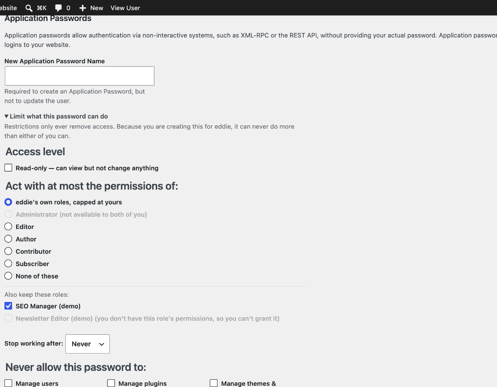
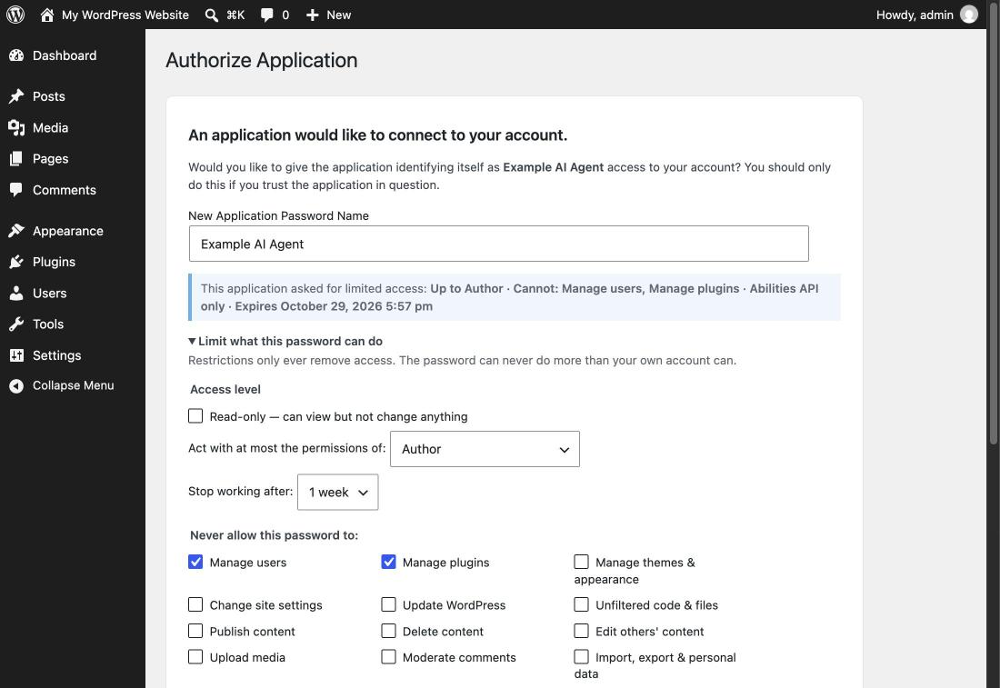
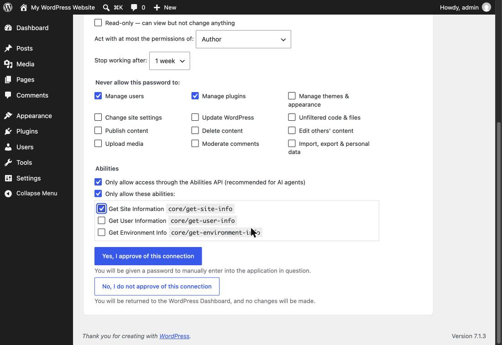
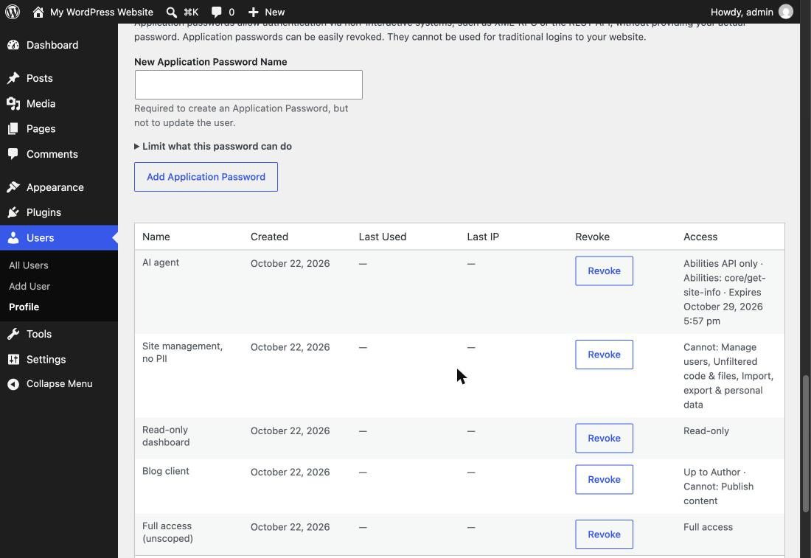

# Scoped Application Passwords

> An exploration of per-password permissions for WordPress Application Passwords.

[](https://playground.wordpress.net/?blueprint-url=https%3A%2F%2Fraw.githubusercontent.com%2Fgeorgestephanis%2Fapplication-passwords-scoped%2Ftrunk%2F.github%2Fblueprint.json)

When Application Passwords [merged into core in 5.6](https://make.wordpress.org/core/2020/11/05/application-passwords-integration-guide/), scoping individual passwords was explicitly left as a follow-up. Today, every application password carries the full power of the user who made it. If an administrator connects a blog client, a read-only dashboard, and an AI agent, all three can install plugins.

This plugin is a working prototype of what scoping could look like. It is built only on hooks core already ships, so it doubles as a test of whether those hooks are enough. They almost are (see [What core would need](#what-core-would-need)).

## Restriction types

Every restriction only removes access. A scope can never give a password more than its user has.

| Restriction | Example | Where it's enforced |
|---|---|---|
| **Roles** | An admin's password acts as at most an *Author*, keeping *SEO Manager* but dropping *Forum Keymaster* | `map_meta_cap` |
| **Denied capability groups** | "Never: manage plugins, manage users" | `map_meta_cap` |
| **Read-only** | GET/HEAD/OPTIONS only | `rest_pre_dispatch` |
| **Abilities allowlist** | Only `core/get-site-info`, `my-plugin/*` | `wp_ability_permission_result` |
| **Abilities-only** | REST access limited to `/wp-abilities/v1` | `rest_pre_dispatch` |
| **Expiry** | Stops working after 7 days | `wp_authenticate_application_password_errors` |
| **Granter cap** *(automatic)* | A password an admin creates for someone else can't exceed what the admin can do | `map_meta_cap` |

These combine, for example: an Author ceiling, no publishing, expiring in a week.

### Roles: a ladder plus toggles

Core's roles nest: Administrator ⊃ Editor ⊃ Author ⊃ Contributor ⊃ Subscriber. Plugin roles usually don't. bbPress's Keymaster, Yoast's SEO Manager and similar roles are held *alongside* a core role and grant an unrelated set of capabilities. A single "at most X" ceiling can't express "keep SEO Manager, drop Keymaster".

So a scope stores a **list** of roles (`roles: ["author", "wpseo_manager"]`). The password may use a capability only if the user has it *and* at least one listed role grants it. The UI presents that list as:

- **Radio buttons for the core ladder**, with rungs above the user's own role shown but disabled.
- **Checkboxes for every other role the user holds**, each kept or dropped independently.

Which roles count as the ladder is filterable via `application_password_scope_hierarchical_roles`.

### Scoping someone else's password

An administrator can create passwords for other users. Without care, that's a way to mint credentials stronger than the creator's own. On multisite, for example, a site admin could create a password for a super admin. So whenever the acting user isn't the owner:

- The plugin records **`granted_by`** on the password, even if no scope was requested. Every capability must then pass for *both* the owner and the granter. If the granter is later deleted, the password stops working.
- The form greys out any role or toggle the granter couldn't hand over. It also says, by name, that the password can't do more than either user can.



### Why both roles *and* capability groups?

They answer different questions:

- A **role limit** ("act as an Author") is easy for people to understand. It also covers capabilities from plugins that the scope author never heard of: if the Author role doesn't have `manage_woocommerce`, the password doesn't either.
- **Capability groups** ("anything except plugins") keep a high-trust integration's power while cutting the parts that make a leaked credential catastrophic. Raw capabilities like `promote_users` are too fine-grained for someone approving an app, so they are bundled into about a dozen named groups. The groups are filterable via `application_password_scope_capability_groups`.

### How the Abilities API fits

The [Abilities API](https://make.wordpress.org/core/2025/11/10/abilities-api-in-wordpress-6-9/) is a natural fit for the *positive* side of scoping, meaning *what may this password do?* rather than *what may it not do?*:

- Abilities are named and described, with input/output schemas. That makes them a far better unit for consent ("Allow *Create draft post*") than capabilities or REST routes.
- `readonly` and `destructive` annotations let read-only mode apply to abilities by metadata instead of guesswork.
- **Abilities-only** mode is a strong option for AI agents and MCP clients. The agent sees a curated surface of declared operations instead of the whole REST API.

The Abilities API does not replace capability scoping. Ability `permission_callback`s still call `current_user_can()`, so both layers apply: a password allowed to run `my-plugin/delete-everything` under an Author ceiling still fails the ability's own capability check. Most of the REST API is also not expressed as abilities yet.

## How it works

1. `application_password_did_authenticate` records which password authenticated and loads its scope.
2. A `map_meta_cap` filter at `PHP_INT_MAX` checks every primitive capability the authenticated user needs against the scope. If any is out of scope, the result is `do_not_allow`. This covers REST, XML-RPC, abilities, and any plugin code calling `current_user_can()`.
3. Request-level rules (read-only, abilities-only) run in `rest_pre_dispatch`, which also runs per sub-request inside `/batch/v1`.
4. Scopes are stored in user meta (`_application_password_scopes`), keyed by password UUID, and removed when the password is deleted.

### Escalation hardening

A scoped password could otherwise free itself. Any password with *any* restriction is therefore denied:

- `create_app_password`, `edit_app_password`, and `delete_app_password(s)`, so it can't mint an unscoped sibling or rewrite its own scope.
- `edit_user`, `delete_user`, `promote_user`, and `remove_user` **on its own account**, so it can't change the account's email or password and then log in with a full cookie session.
- On multisite, a password with a role limit or denied groups is removed from `site_admins` for that request, because `is_super_admin()` skips `map_meta_cap`. The technique is borrowed from [t3admin](https://github.com/georgestephanis/t3admin).
- Over XML-RPC, which has no read/write metadata, a password with request-level restrictions fails authentication instead of being silently under-enforced.

A password can always `GET …/application-passwords/introspect`, so the client can discover what it was actually granted.

## Interfaces

**Authorize Application flow.** An app can *request* a scope in the authorize URL. The person approving sees it pre-filled and can change it before approving:

```
/wp-admin/authorize-application.php?app_name=My+Agent
    &scope[roles][]=author&scope[roles][]=wpseo_manager
    &scope[deny][]=plugins&scope[deny][]=users
    &scope[abilities_only]=1
    &scope[expires_in]=604800
```





**Profile screen.** A collapsible *Limit what this password can do* section under *Add New Application Password*, and an *Access* column in the list table.



**REST.** A `scope` field on the core `/wp/v2/users/<id>/application-passwords` endpoints, readable and writable on create and update:

```json
{
  "name": "Reporting dashboard",
  "scope": { "read_only": true, "expires_in": 2592000 }
}
```

**WP-CLI.**

```bash
wp application-password scope set admin <uuid> --roles=author,wpseo_manager --deny=plugins,users --expires-in=86400
wp application-password scope set admin <uuid> --abilities-only --abilities='core/get-site-info,my-plugin/*'
wp application-password scope get admin <uuid> --format=summary
wp application-password scope clear admin <uuid>
wp application-password scope groups
```

## What core would need

Almost everything was possible with existing hooks, which is a credit to the 5.6 extension points. The gaps:

1. **A place for metadata on the password item.** `WP_Application_Passwords::update_application_password()` only round-trips known keys, so scopes live in a parallel meta row. A `scope` (or general `meta`) key on the item would remove that.
2. **The active password should be known outside REST.** `rest_get_authenticated_app_password()` is REST-only, and XML-RPC has no equivalent. A generic `wp_get_authenticated_application_password()` would help.
3. **`is_super_admin()` has no filter**, so restricting a super admin takes an option-filter workaround.
4. **Read-only is method-based.** It relies on GET endpoints not mutating state. That holds for core but isn't guaranteed for plugins. Per-route `readonly` annotations, like abilities have, would make this stronger.
5. **Authorize-flow protocol.** `scope` in the authorize URL is invented here. A core-blessed format, and a way to report the *granted* scope back on the `success_url`, would let apps request least privilege consistently.

## Open questions

- Should approvers be able to *loosen* what an app requested, or only tighten it? This prototype allows both, with the request shown prominently.
- Should a scope be editable after creation? Changing a scope silently changes the authority behind an existing credential. Revoke-and-reissue may be the safer UX. The REST/CLI here allow edits; the UI does not.
- Are a dozen capability groups the right granularity? Should plugins register their own groups, the way WooCommerce might?
- Should scoping be mandatory for some new passwords, for example defaulting AI-agent connections to abilities-only?

## Development

```bash
composer install
composer phpcs
```

Requires WordPress 6.9+ (Abilities API) and PHP 7.4+. The Playground link above sets up a few example scoped passwords and opens the authorize screen with a pre-filled scope request.

## License

GPL-2.0-or-later
